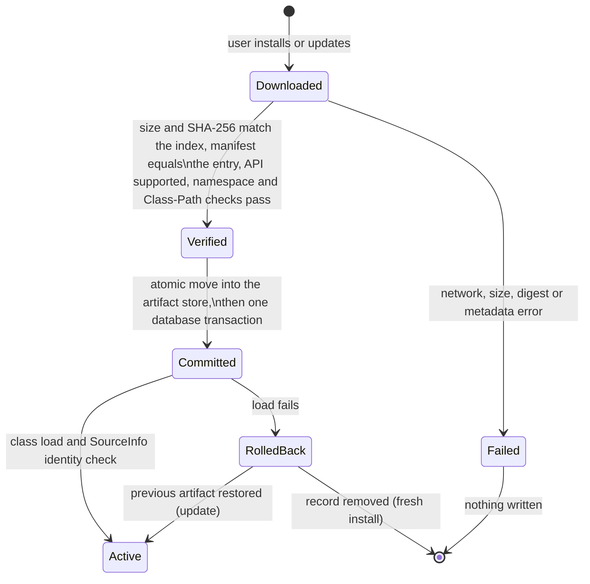

# Desktop extension distribution

This defines how Desktop discovers, verifies, installs, updates and removes
extension JARs. It is the contract for [#440](https://github.com/Operation-Grimoire/grimoire/issues/440).
Implementation follows in separate changes. Until then, Desktop accepts only
operator-selected local manifests (see [desktop](desktop.md)).

Each extension keeps one source directory. The extensions repository builds an
APK and a thin JAR from it. Android keeps its APK index and installer unchanged.
Desktop reads a separate signed JAR index from the same release.

A digest or signature authenticates the bytes the repository published. It is
not a sandbox. An installed extension runs with Desktop's permissions.

## Published artifacts

Each repository release publishes these files next to `index.json`:

| File | Content |
| --- | --- |
| `jar-index.json` | JAR index, format 1 (below). UTF-8 JSON. |
| `jar-index.json.sig` | Base64 Ed25519 signature over the exact bytes of `jar-index.json`. |
| `<package>-<versionName>.jar` | One thin JAR per extension, built from its existing source directory. |
| `extensions-lib-<version>.jar` | The shared extensions library, when any extension requires it. |

The signing key is dedicated to the JAR index. It is not the APK signing key.
CI holds the private key as a repository secret. Desktop builds pin the public
key of the official repository.

### Index format 1

```json
{
  "format": 1,
  "repository": "io.grimoire.extensions",
  "sequence": 1763460000,
  "libraries": [
    { "coordinate": "io.grimoire:extensions-lib:1.2.0",
      "file": "extensions-lib-1.2.0.jar", "sha256": "…", "size": 81234 }
  ],
  "extensions": [
    { "pkg": "io.grimoire.extension.en.royalroad", "name": "Royal Road", "lang": "en",
      "sourceClass": "io.grimoire.extension.en.royalroad.RoyalRoad",
      "versionCode": 7, "versionName": "1.0.4", "sourceVersionCode": 4,
      "coreApi": "1.6", "hostLibraries": ["org.json:json:20240303"],
      "file": "io.grimoire.extension.en.royalroad-1.0.4.jar", "sha256": "…", "size": 40211,
      "adultContent": "NONE", "iconUrl": "https://…" }
  ]
}
```

- `repository` is a stable identifier. Trust is bound to it together with the key.
- `sequence` increases with every publication. CI uses the generation time in
  epoch seconds and publishes under one concurrency group.
- `file` values are plain names resolved against the index URL. Desktop
  downloads only over HTTPS. Redirects are allowed because the digest pins the bytes.
  Index URLs cannot contain a query or fragment.
- `sha256` is lowercase hex. `size` is the exact byte count, at most 20 MiB.
- Every entry field must equal the JAR's `Grimoire-*` manifest attribute it
  mirrors. A mismatch rejects the artifact before any class loads.
- Unknown fields are ignored. Unknown `format` values are rejected.
- An entry this Desktop cannot run (API or host library) is listed as
  incompatible. It never rejects the rest of the index.

## Trust enrollment and revocation

A trusted repository is the tuple *(index URL, repository identifier, Ed25519 public key)*.

- **Official repository.** Desktop ships it enrolled and enabled, with a pinned
  key. It can be disabled but not removed. A key rotation or revocation ships as
  a Desktop update. A built-in repository that a Desktop update drops is revoked:
  its row is deleted and its installed extensions stop loading.
- **Other repositories.** The user enters the index URL and the repository's
  public key, obtained from the publisher. Desktop downloads the index, verifies
  the signature with that key, then shows the repository identifier, key
  fingerprint and extension count. The repository is enrolled only after the
  user confirms. Desktop never trusts a key it fetched from the repository itself.
- **One owner per package.** An installed package belongs to the repository
  identifier *and key* that installed it. Another repository, or the same
  identifier enrolled later under a different key, cannot load, update or
  replace it. Desktop warns about this when such a repository is added. To
  switch, the user removes the extension first. Only the official repository may
  rotate its key, through a Desktop update.
- **Removing a repository** revokes its trust. Its installed extensions stop
  loading and show as untrusted. The user can remove them or enroll the
  repository again. Library entries, downloaded chapters and reading state are kept.
- **Disabling a repository** stops index refreshes but keeps its installed extensions.

## Index acceptance, replay and downgrade

Desktop stores, per repository, the highest accepted `sequence` and the SHA-256
of that index's bytes. A fetched index is accepted only when all of these hold:

1. The signature verifies with the enrolled key over the exact downloaded bytes.
2. `format` is 1 and `repository` equals the enrolled identifier.
3. `sequence` is greater than the stored value, or equal with identical bytes.

A rejected index never replaces the stored catalog. The previous accepted catalog
stays usable for installs that are already listed in it.

A stale but valid index cannot be detected without an expiry. Format 1 has no
expiry so that a repository with no recent releases does not block installs.
An attacker who can serve an old signed index can only withhold newer versions,
because of the sequence and version rules.

Package rules:

- An update requires a higher `versionCode` than the installed one.
- An equal `versionCode` must have the installed digest. Otherwise the entry is a
  conflict and is not offered.
- A lower `versionCode` is never installed over a newer one.
- An extension whose `coreApi` the host does not support is listed as
  incompatible and is not offered.

## Install and update



1. **Download** into memory with a hard size limit (20 MiB). Nothing is written
   and no class is loaded.
2. **Verify** the bytes against the index entry and the existing loader checks:
   format, package namespace, entry point, versions, `Grimoire-Core-Api`,
   host libraries, duplicate entries and external `Class-Path`.
3. **Commit.** Write the bytes to `extensions/staging/`, flush them, and move
   them atomically to `extensions/artifacts/<sha256>.jar`.
   In one SQLite transaction, record the package, repository, versions, digest,
   library digest and the previous digest for an update.
4. **Activate.** Load a verified snapshot in a new class loader, after checking
   that the JAR's central directory lists exactly the entries that were streamed
   and checked. If the source class fails to load (including an `Error` from its
   initializer) or its `SourceInfo` name does not match the entry, restore the
   previous digest (update) or delete the record (install). Close the old class
   loader only after the new one is active.

Libraries use the same path. A library is shared by digest. It is kept while any
installed extension references it.

## Removal

Removal deletes the installed record in one transaction, closes the class loader
and leaves the artifact for collection. Library entries, downloaded chapters,
reading progress and history for that source are kept, as on Android. Browse
stops listing the source immediately.

## Startup, offline use and recovery

At startup Desktop:

1. Deletes everything in `extensions/staging/`. Interrupted writes never resume.
2. For each installed record, re-hashes the artifact and re-runs the metadata
   and API checks before loading. A missing or changed file, an unsupported API
   after a Desktop update, or a revoked repository marks the extension
   unavailable with its reason. Desktop does not repair it silently.
3. Deletes artifacts that no record references.

Installed extensions load from the local store without network access. Only
index refreshes, installs and updates need the network. Offline mode blocks them.

| Interruption point | State after restart |
| --- | --- |
| During download | Nothing was written. Nothing installed or changed. |
| After move, before commit | Unreferenced artifact collected. Previous version active. |
| After commit, before activation | New version loads at startup, with all checks. |
| Activation failed | Previous version (update) or no record (install). Reason shown. |

## Storage

SQL5 adds two tables. SQL4 data is not rewritten. Older builds refuse SQL5, as
with earlier upgrades.

- `extension_repositories(repository PK, index_url, public_key, sequence,
  index_sha256, catalog, enabled, builtin)`. `catalog` holds the accepted index bytes.
- `installed_extensions(pkg PK, repository, repository_key, metadata, sha256,
  previous, library_coordinate, library_sha256, installed_at)`. `metadata` and
  `previous` are JSON records of the active and previous artifact.

## Local manifests

**Open local extension** remains for development. It loads for the current
session only, is not recorded as installed and does not override an installed
package with the same name.

## Acceptance

Each item needs exact artifacts and an executed test:

- Signature: wrong key, modified index bytes, modified signature, wrong `repository`.
- Replay: lower `sequence`, and equal `sequence` with different bytes.
- Artifact: wrong digest, wrong size, oversized file, manifest field differing
  from the index, unsupported API, foreign classes, external `Class-Path`.
- Package: downgrade, equal version with a different digest, package owned by
  another repository.
- Lifecycle: interrupted download, crash after move and after commit, failed
  activation with rollback, artifact changed on disk, revoked repository.
- Restart: installed sources appear in Browse after restart, offline too.
  Removed sources disappear from Browse.
- Publication: CI builds APK and JAR from the same source directories and the
  published JAR index verifies with the pinned key.
