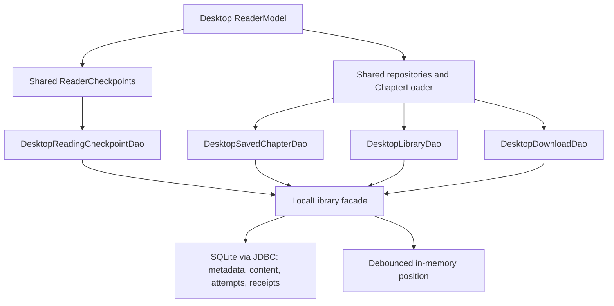

# Desktop storage

Desktop implements the shared saved-chapter, membership and guarded-download
contracts with SQLite via JDBC. Android keeps Room. The shared interfaces carry
portable keys and values; neither platform imports the other's database classes.
Extensions still have one source implementation, packaged as APK or JAR.

## Backend decision

| Option | Fit for the current desktop JVM module | Cost |
| --- | --- | --- |
| SQLite via JDBC (selected) | One transaction covers chapter content, downloaded state and receipt; keeps existing JVM build. | Handwritten SQL/migrations and native driver validation on every supported OS. |
| Room for desktop | Viable desktop backend with generated DAOs. | Adds ORM/code-generation/build integration; the existing Android entities and triggers still need platform-specific adaptation. |
| JSON plus chapter files | Retains the old layout. | Requires our own journal, transaction/recovery protocol and multi-file consistency implementation. |

[Xerial's driver](https://github.com/xerial/sqlite-jdbc) bundles native libraries
for Windows, macOS and Linux. Desktop pins
[3.54.1.0](https://github.com/xerial/sqlite-jdbc/releases/tag/3.54.1.0).
Driver/native extraction failures are startup errors, never reasons to reset a
store. Room is also a supported
[desktop option](https://developer.android.com/kotlin/multiplatform/room);
this decision follows the current module's needs, rather than restricting the
shared contract to JDBC or one ORM. The dependency belongs only to `desktop`.

## Storage and ownership

`library.sqlite` has application ID `0x4752494D` and schema version 3. SQL1 upgrades
atomically by adding empty checkpoint and reading-state/receipt tables; SQL2 adds
only the reading-state/receipt tables. These #447 migrations do not rewrite existing rows;
startup still resets abandoned active download ownership under the exclusive lease.
`books` stores the existing metadata projection; `contents` stores payload,
explicit codec version, digest, revision, word count and ownership/receipt data.
The downloaded set derives from `has_content`, so an indexed corrupt or missing
body is an integrity error. It never becomes a network fallback or legacy-file
repair. Format1 imports retain their original body and format version; new saves
use the existing shared format2 codec.

One OS file lease (`.library.lock`) permits one writer process. Connection access
is serialized by the facade, and coroutine adapters dispatch blocking work to IO.
The lease spans the reader lifetime and is released only after a successful flush
and close. A failed flush retains pending positions and a usable model for retry.
No database write runs on the scroll callback. Metadata patches read current SQL
state; pending positions cannot overwrite committed content or receipts.

Claim records a random attempt ID, current revision and owner. Commit rechecks
current chapter eligibility, owner and revision. The body, download projection,
word count and receipt become visible together after SQL commit. Identical retries
return the current receipt; changed payloads conflict. Superseded/canceled tokens
are stale. Removal/relock invalidates tokens and replay receipts; deletion also
removes the downloaded projection. Failure/cancellation preserves prior content.
Opening under the exclusive lease revokes abandoned live tokens from a dead owner.
A committed receipt remains replayable after restart.

An exception after commit can mean a lost confirmation. The reader checks that
attempt's current receipt and digest before reporting failure. Adding the novel
to the library is separate: a failed membership update explicitly reports that
the chapter was saved. Neither operation changes reading history or navigation.

The store requires local storage, enables foreign keys and a busy timeout, and
verifies WAL and `synchronous=FULL`. SQLite describes these settings in its
[PRAGMA reference](https://www.sqlite.org/pragma.html#pragma_synchronous).
[WAL requires a local filesystem](https://www.sqlite.org/wal.html), and the
handoff requires atomic rename support. These settings and process tests do not
prove survival of arbitrary hardware/filesystem failure or sudden power loss.

## Upgrade and downgrade

1. Close every older desktop reader. Retain a complete copy of its data directory.
2. On first open, validate schema1 `library.json` and every indexed chapter file,
   including identity, digest and codec. Invalid or missing indexed data aborts
   the upgrade; unknown database/file versions are never silently reset.
3. Import metadata and raw payloads into an app-owned temporary SQLite database,
   processing one chapter payload at a time. Manifest metadata and per-chapter
   fingerprints still load fully into memory.
   Persist the source fingerprints with an `imported` phase, recheck the sources,
   then atomically publish `library.sqlite`.
4. Atomically publish the exact manifest bytes in `library.json.before-sqlite`
   from a forced temporary copy and leave every
   old chapter file unchanged. Atomically replace `library.json` with a schema2
   handoff marker containing this database's random ID, then mark the DB active.
5. A restart with an imported database validates the retained source fingerprints
   before completing an unwritten handoff, or validates the matching marker after
   handoff. Conflicts abort without overwriting the evidence. Unpublished temporary
   databases are never automatically adopted.

Older readers require manifest schema1 and therefore refuse the upgraded directory.
They do not honor the new OS lease; the new reader checks its marker before access
and refuses an overwritten marker. This cannot safely coordinate with an already
running old reader, hence the close-before-upgrade requirement.

Downgrade requires restoring the coherent full pre-upgrade directory while all
readers are closed. The retained files are recovery evidence, not an automatic
reverse migration: they do not contain new SQLite downloads or later metadata.
Do not replace just the marker or delete the database to force an old reader to
open. For backup of an active WAL database use a coherent SQLite backup, or close
the reader and copy its complete data directory, rather than copying the main DB
alone. There is no automatic data deletion or old-file garbage collection.

## Verification boundaries

`:desktop:test` exercises real SQLite, shared repository compositions, integrity
failures, rollback, cancellation, idempotency, stale callbacks, metadata changes,
source isolation, pending positions and reader save/error behavior. Separate JVMs
are forcibly stopped before/after SQL commit and before/after migration handoff.
Migration death before database or backup publication leaves unpublished files
untouched; partial temporary backups are never adopted.
Tests inspect raw SQL, reopen through the production facade, verify old/new receipt
and body consistency, and reject a competing process. Fixtures use isolated
temporary directories; no test opens a personal library or kills unrelated Java.
A bounded-heap worker imports 80 MiB of legacy payloads with a 48 MiB heap.

CI runs these unit/storage tests on Windows, Linux and macOS. Source-neutral
packaged-extension and Compose app journeys run on Windows/Linux using the same
production composition. A separate Royal Road compatibility smoke uses external
source fixtures; ordinary app tests need no external checkout. Native app chrome, dialogs, installer/signing/update
behavior, real macOS UI and power-loss testing remain separate acceptance gates.
Android process-death and native-window acceptance remain future runtime gates.
Shared reading-anchor semantics, projection and guarded per-chapter capture/restore/flush
are implemented. Measured local layout hints and historical legacy-anchor conversion
remain separate. See the [implemented contract and proof limits](reading-anchors.md).

## Coherent reader load observations

The SQLite adapter now reads saved presence/body and protocol generation in one
transaction. Unsaved available chapters receive an empty `contents` metadata row;
this is not a download and changes no book, position or payload field. Existing
saved rows retain bytes, cache revision and receipts. A scope tied to the open
LocalLibrary prevents reuse after close/reopen, even if a revision is unchanged.
Removal/relock, cache deletion and commit rotate the existing revision; identical
content does not revive an old observation. Only available subjects receive an
observation. Existing access errors for locked/removed chapters with retained
content still propagate; they are not reclassified as absence for source fallback.

The production reader retains that observation with the loaded projection. A
source fetch can finish after a concurrent save; it retains the earlier absence
stamp and a freshness check rejects that stamp. It must not claim the new stored
generation for the old source result. This check is read-only, never reseeds a
missing record and grants no write authority. Session registration and checkpoint
commits now compare those guards inside their own transaction. The observation
stage alone introduced no portable writes; reader adoption now uses the registered
coordinator below, with legacy fields retained as compatibility metadata.

## Guarded reading checkpoints

`DesktopReadingCheckpointDao` uses the same facade serialization and SQLite
transaction boundary as content writers. It calls the shared registration and
commit decisions described in [reading anchors](reading-anchors.md#guarded-checkpoint-storage).
Checkpoint state is per chapter, separate from the legacy novel position. It does
not select a resume chapter, update read/history flags, or store source bodies.
Portable checkpoints survive reopening; session authority does not. SQL2 rejects
old SQL1 readers. Retain a full pre-upgrade directory copy for rollback.

The production reader now uses the shared `ReaderCheckpoints` coordinator for
portable capture/restore/flush, with real scroll-input gating and paragraph-boundary
restoration. Its legacy debounced position remains compatibility metadata and resume
selection. A rejected load can discard only its own buffer, never a newer view's
selection. See the [workflow and acceptance limits](reading-anchors.md#production-capture-restoration-and-flush).

The optional `resumeChapterUrl` book metadata field records explicit navigation
without creating a position. Old libraries fall back to their known legacy chapter.
This separates Continue reading from initial layout; checkpoint drains cannot select
an older chapter. The new metadata field is additive; SQL schema and saved-content
format are unchanged. Existing chapter selection and membership patches preserve it.
