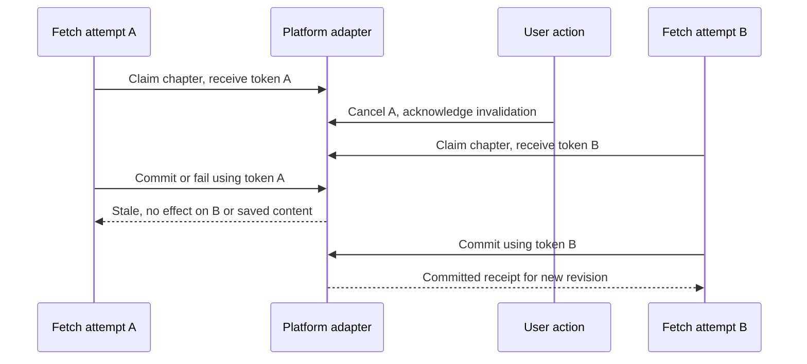

# Guarded download commits

This is the target behaviour for the next shared storage slice, before adding a
write interface. The current adapters do not yet meet every requirement below.
Android and desktop keep their own backend implementations. This contract does
not choose Room, SQLite or files for desktop.

The unit of success is one committed chapter payload and its completion metadata.
Fetching, queue scheduling, image caching, library membership and reading position
are separate operations. Existing content formats and Android status ordinals
remain compatible until an implementation explicitly migrates them.

## Current implementation and gaps

| Area | Implemented behaviour | Gap before shared writes |
| --- | --- | --- |
| Android success | `finishDownload` guards active status, then changes body/version, completion status and word count in a Room transaction. | Status alone does not identify the attempt that owns the response. |
| Android failure | `updateActiveDownloadStatus` changes only active rows. Refresh errors retain saved content. | An old error or connectivity retry can change a newer active attempt. |
| Android cancellation/restart | Cancel restores fresh attempts to NONE and refreshes to DOWNLOADED. Drain reset puts interrupted active rows back in the queue. | All cancellation, deletion, claim and reset paths must revoke the old attempt identity. |
| Desktop save | `LocalLibrary.download` writes the body, changes memory, then writes `library.json`. A monitor serializes that instance. | Body and index have separate publication points; failed saves can leave memory or an existing body's bytes changed. Multiple instances/processes are not coordinated. |
| Desktop file replacement | Temporary file, then atomic move when supported; otherwise ordinary replacement. | This is not a transaction over body and index, or a power-loss durability guarantee. |
| Images | Android fetches images after text commit; image failure does not undo text. | Image publication must be tied to the committed content revision, including deletion and replacement races. |

These are source-inspection findings, not newly executed failure-injection proof.
See [ChapterDao](../app/src/main/java/io/grimoire/app/data/local/dao/ChapterDao.kt),
[DownloadManager](../app/src/main/java/io/grimoire/app/data/download/DownloadManager.kt),
[DownloadDrain](../app/src/main/java/io/grimoire/app/data/download/DownloadDrain.kt)
and [LocalLibrary](../desktop/src/main/kotlin/io/grimoire/desktop/LocalLibrary.kt).

## Attempt ownership and committed state

An attempt has a portable `ChapterKey` and an opaque, adapter-issued identifier.
The adapter binds it to the stored chapter incarnation, the current writer owner
and the expected previous content revision. Never use a status ordinal, row ID,
URL alone or coroutine cancellation flag as the attempt identifier.

Claiming an attempt and recording its ownership must be one guarded operation.
Fresh and refresh eligibility come from current storage, not a stale UI snapshot.
Keep the existing source/local-book and locked-chapter restrictions. Recheck
chapter existence, incarnation, lock eligibility and ownership at commit.
Source permissions and platform access policy still apply before retrieval.
Network attempts acquire ownership before fetching. Desktop's explicit save of
already-loaded pages may claim at the save action; it must not add a network
fetch or bypass the current chapter/source identity checks.

A committed snapshot contains the payload and explicit format version, its
identity/digest, the saved/completion projection and word-count update. Derive
word count with the shared `chapterWordCount`; retain the previous count when
the result is zero, matching Android's current rule. Do not change reading flags,
anchors, first-read history, library membership or unrelated novel metadata.
Legacy snapshots need an adapter-defined revision before guarded writes begin;
missing or corrupt storage must not be invented into a successful download.

The shared facade prepares and validates the supported payload format. Existing
readability rules remain explicit: Android downloads accept prose, formatted
content or images; desktop currently requires nonblank plain text. This contract
does not silently unify those rules or reinterpret a valid empty saved record.

Cancellation, deletion, replacement/import, chapter removal/recreation, ownership
reset and a new claim invalidate the appropriate earlier attempt. Invalidation
and the guarded commit must use the same backend serialization boundary. An
unsent cancellation request is not yet an acknowledged invalidation.

With the current Android guard, A can see status DOWNLOADING after B is claimed
and be accepted. The same problem applies to A's error callback. The new contract
must reject both, even if source code ignores cancellation or a row ID is reused.

## Outcome table

`Committed`, `NotApplied` and the receipt below describe required semantics, not
Kotlin declarations. Settle API names when implementing the contract.

| Event | Required outcome | Effect on committed content |
| --- | --- | --- |
| Current attempt commits valid content | `Committed(receipt, replayed=false)` after the backend commit boundary. | New complete snapshot; a refresh replaces the previous snapshot together with its completion metadata. |
| Same attempt and identical payload retried while its committed revision is current | `Committed` with the same receipt and `replayed=true`. | No second write, revision change or duplicate success side effect. |
| Current committed attempt identifier reused with different payload | Explicit conflict; never reinterpret it as a retry. | No change. |
| Uncommitted attempt revoked, superseded, from an old owner or based on an obsolete revision | `NotApplied(stale)`. | No change to saved content or any newer attempt. |
| Chapter missing, recreated or no longer eligible | `NotApplied` with a reason, or an access failure according to platform policy. | No record creation or resurrection. |
| Invalid identity, codec version or payload | Validation failure before publication. | No change. |
| Cancellation observed before entering commit | Propagate cancellation. | No new committed snapshot; any earlier claim still needs its normal owner cleanup. |
| Cancellation wins the serialized race | Commit is stale. Fresh cancellation restores NONE; refresh cancellation retains the previous saved snapshot. | Prior snapshot retained. |
| Authorized deletion wins the serialized race | Commit is stale; the deleted snapshot/receipt cannot be revived. | Content remains absent. Chapter metadata follows the delete operation's scope. |
| Authorized replacement/import wins the serialized race | Commit is stale; the replacement controls the current snapshot and receipt. | Replacement content retained, or absence if that operation removed content. Never restore the pre-replacement snapshot. |
| Commit wins before a later cancellation | Content is committed; a later cancel cannot undo it. | New snapshot retained. Explicit delete or replacement may still change it. |
| I/O failure or cancellation after commit began, including lost confirmation | Propagate failure/cancellation; outcome may be unknown to the caller. | Never infer rollback from the exception. Reconcile against the current receipt. |
| Source fetch fails or loses connectivity | Only the owning attempt may enter error or requeue state. | Prior saved content retained, including failed refreshes. |
| Image caching fails after text commit | Report/cache failure separately; text success remains success. | No text rollback, error downgrade or implicit refetch. |

The receipt identifies the key, attempt, committed content revision, payload
digest/version and resulting completion metadata. It is recorded with the
snapshot, not issued earlier. Supply a coherent lookup of the current receipt
for reconciliation; `SavedChapterRepository.read` alone cannot identify which
attempt committed. Do not deduce success from matching prose or word count.

If delete or replacement is ordered after a commit, that later operation still
applies. A previously confirmed receipt does not pin content against subsequent
authorized changes; replay cannot resurrect it.

A caller that loses the reply may look up the receipt or retry the **same**
attempt and payload. If another commit or deletion has since won, the old attempt
is stale. That says nothing about whether it committed historically. Retaining
an unbounded command history is not required. Retrying must never overwrite a
newer revision merely to recover an earlier response.

Check the current committed receipt before validating live ownership: an
identical replay only acknowledges existing data, including after a process
restart or while a refresh is fetching. It cannot change that refresh's ownership.
Unknown/noncurrent identifiers are stale regardless of payload; no historical
payload-conflict detection is promised after its receipt is superseded. A live
attempt's first successful commit binds its payload digest for later replay.

The guarantee concerns coherent snapshots. Readers started before a commit may
return the previous snapshot; separate reads may straddle a commit. A coherent
read must not combine one revision's body with another revision's completion
metadata. Reactive consumers need not observe every intermediate queue event.

## Restart, durability and ownership scope

| Boundary | Required guarantee |
| --- | --- |
| Graceful close/reopen | A confirmed commit remains available unless a later authorized operation changed it. |
| Process termination before publication | Reopen serves the prior committed snapshot; uncommitted staging is not a download. |
| Process termination during publication | Recovery selects one complete old or new snapshot. Never expose a mixed snapshot as downloaded. |
| Process termination after confirmed publication | Reopen retains the confirmed snapshot, absent later writes or external storage failure. |
| Power loss, filesystem/device failure or external modification | No universal no-data-loss promise. Apply backend/OS durability limits and integrity checks; fail explicitly on damaged or unsupported published data. |
| Competing owners | One writer owner per store for this slice. Coordinate or refuse a second owner before it can publish; silently overwriting another instance's snapshot is unsupported. |

Recover before accepting new writes. Revoke interrupted ownership and preserve
the fresh-versus-refresh distinction when requeuing Android work. A new owner
must never reuse a previous owner's live token. Do not reset another live owner's
work merely because a drain started. Multi-process scheduling is outside this
slice; a process-local mutex is not proof of cross-process coordination.

Temporary payloads without a committed reference remain uncommitted. Cleanup
may remove only staging proven to belong to the protocol and to be unreferenced.
Do not adopt an orphan merely because its key/hash matches, scan arbitrary files
into the library, delete corruption evidence or fetch a replacement automatically.
The existing strict saved-read failure behaviour remains in force.

## Adapter obligations

**Android:** match the attempt and expected revision and update content/version,
completion, positive word count and receipt in the same Room transaction. Apply
ownership guards to error/requeue callbacks too. Update every single/bulk cancel,
delete, retry, claim and interrupted-work reset path. Imports, restore and chapter
reconciliation must invalidate ownership when they replace/remove its target;
do not route local imports through network-download eligibility. Any new schema
needs a separately tested migration and explicit old-APK rollback boundary.

**Desktop:** select the backend independently. If retaining files, keep the old
payload until a new complete snapshot is published through one recoverable
commit boundary. Publishing a replacement body in place before its index is
insufficient. Publish in-memory download state only after that boundary; reconcile
unknown outcomes before another stale memory snapshot can flush over committed
data. The current ordinary-move fallback cannot be assumed to satisfy this
boundary. Prove the selected filesystem protocol or use backend transactions.
No specific file layout or database technology is selected here.

Both adapters preserve metadata changed while retrieval was running. Keep large
Android content reads bounded; do not copy a stale whole chapter/novel entity
back over progress or user edits. A desktop chapter commit and automatic library
membership remain separate operations: a membership failure must not claim that
an already committed chapter failed to save.

Images are optional cache data after text commit. Bind image files/publication
to the committed content revision, not just chapter URL and page index. Images
from an obsolete revision must not become visible with newer text or recreate a
deleted download. A failed/stale text commit must not publish images. An older
revision's cache work may finish privately, but readers resolve only the current
committed revision. Missing images retain the existing platform rendering policy.

## Implementation order and acceptance

1. Add shared attempt/receipt/result models and a guarded commit facade, with
   shared state-transition scenarios. Keep queue execution and backend mechanisms
   local. Require cancellation and unknown-outcome handling in the API contract.
2. Implement the Android adapter and migrate success, error and connectivity
   callbacks together with every ownership-invalidating path. Preserve existing
   queue status ordinals, source gates and refresh content. Validate migration
   and retained bytes before publishing a signed beta.
3. Implement the independently selected desktop adapter and migrate its save
   action. Prove body/index recovery, ownership and commit-before-memory behaviour
   before presenting it as equivalent to the Android contract.
4. Run the same scenario matrix through both production compositions; then
   complete revision-bound image-cache adoption before closing the write slice.
   Each intermediate PR must state which callers and gates remain unfinished.

| Required scenario | Evidence needed |
| --- | --- |
| Fresh and refresh success, positive/zero word count | Complete snapshot and retained unrelated fields through both adapters. |
| A canceled, B claimed, late A success/error/connectivity retry | A cannot alter B, committed bytes or completion state; same statuses are not sufficient. |
| Duplicate same-payload commit and conflicting reuse | Stable receipt/no duplicate effects; explicit conflict without mutation. |
| Cancel before commit, race at boundary, lost reply after commit | Deterministic barriers; actual result/cancellation assertions and receipt reconciliation. |
| Delete/recreate/import/restore/lock change during retrieval | Old ownership cannot publish or resurrect a record; local imports still work. |
| Storage failure before publication and after its boundary | Fault injection with exact body/metadata checks; unknown outcome reconciled before further writes. |
| Process killed at staging, publication and confirmation boundaries | Actual restart/reopen recovery, not only caught exceptions or graceful-close tests. |
| Second instance/process and late callback from old owner | Refusal or proven serialization, with no lost update. |
| Image failure and old image completion after refresh/delete | Text stays committed; obsolete images cannot attach to current content. |
| Migration and rollback | Legacy data/progress retained; unsupported old versions fail without destructive fallback. |

These are future acceptance gates. Existing
[codec migration tests](../app/src/androidTest/java/io/grimoire/app/data/local/ChapterCodecMigrationTest.kt)
prove versioned content and the current status guard, not attempt ownership or
crash recovery. Existing desktop storage tests do not prove a transactional
body/index commit. JVM tests, native execution, process-kill recovery, signed-beta
compatibility, reader UI and physical-device acceptance remain separate evidence.
