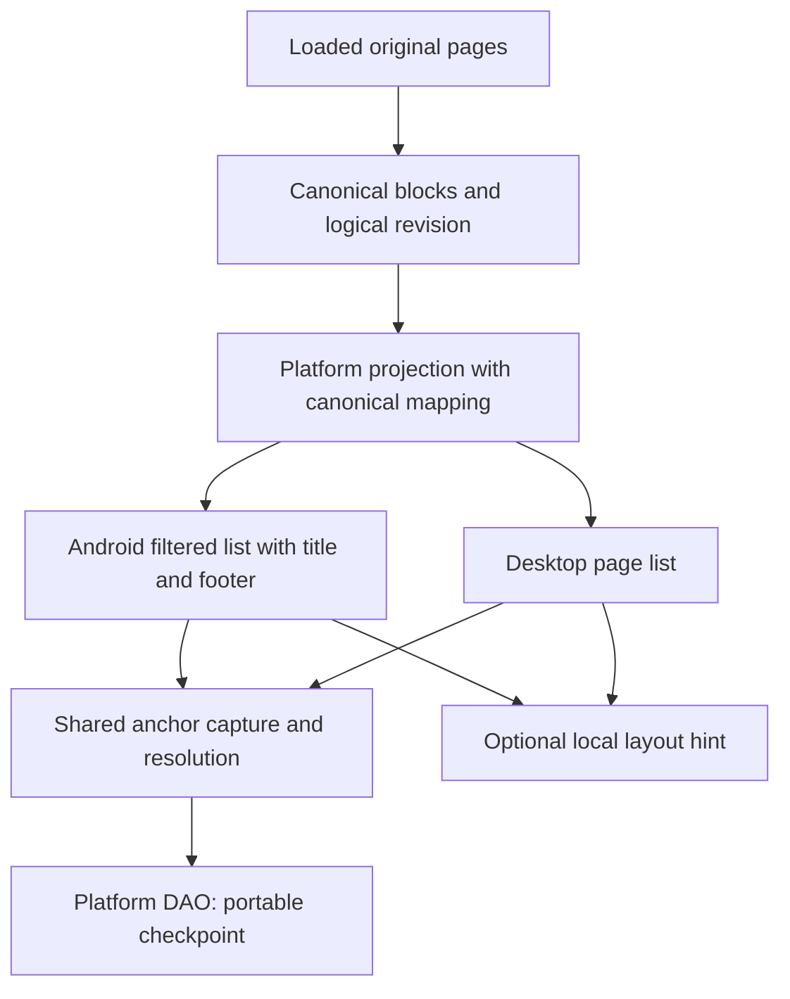
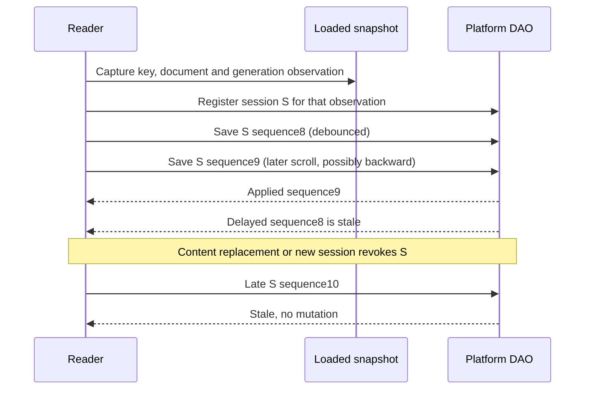

# Portable reading anchors

The pure canonical document, anchor model and resolver are implemented in
`reading-core`. Renderer mappings, local hints/legacy fallback, checkpoint DAO
and production reader adoption are **not implemented**. The contract below also
defines their required behavior. [#425](https://github.com/Operation-Grimoire/grimoire/pull/425)
completed desktop download/storage adoption; its remaining runtime gates still
apply. This contract does not select a new database or define account sync.

A reading anchor identifies a place in chapter content. A list index and pixel
offset identify a place in one rendered layout. Keep those values separate.

## Current behavior and preservation boundary

| Area | Current implementation | Required adoption boundary |
| --- | --- | --- |
| Android capture | `ReaderScreen` saves the first visible lazy-list index and pixel offset. That list filters blank text and adds a title and footer. Its percentage uses the last visible item and total list size. | Map rendered items to original content before sharing an anchor. Do not reinterpret the percentage as a character offset. |
| Android persistence | `ReaderProgressWriter` debounces for 500 ms, serializes writes and drains captured positions on chapter change/exit. `ChapterDao.setReadAnchor` updates progress/index/offset separately from read status. | Preserve captured positions, ordering and separate read/history fields. Add observable error/retry handling before adopting a new writer. |
| Desktop capture | `ReaderPane` saves an index into its page list and a pixel offset, with a 350 ms flush delay. | Preserve local restore behavior while adding a content-relative position. |
| Desktop persistence | `LocalLibrary` retains one legacy position per book, accepts scroll updates in memory and persists on flush/close. Failed autosave keeps accepting later scroll positions. | Import only the legacy position that exists. Other chapters have unknown positions, not inferred starts or completion. |
| Completion/history | Android has percentage, paragraphs-from-end and at-end policies, explicit read/unread commands and first-read history. Desktop has no equivalent completion policy. | Position resolution/migration must not set read/unread, invent completion/history or add Android policy to desktop. |

Sources: [Android screen](../app/src/main/java/io/grimoire/app/ui/screen/reader/ReaderScreen.kt),
[view model](../app/src/main/java/io/grimoire/app/ui/screen/reader/ReaderViewModel.kt),
[progress writer and predicates](../app/src/main/java/io/grimoire/app/ui/screen/reader/ReaderProgress.kt),
[chapter queries](../app/src/main/java/io/grimoire/app/data/local/dao/ChapterDao.kt),
[desktop screen](../desktop/src/main/kotlin/io/grimoire/desktop/Main.kt) and
[desktop store](../desktop/src/main/kotlin/io/grimoire/desktop/LocalLibrary.kt).

## Canonical document and identity

The canonical document is the ordered `NovelPage` sequence from
[ChapterLoader](../reading-core/src/main/kotlin/io/grimoire/reading/ChapterLoader.kt),
before platform filtering, HTML rendering or image-URI substitution. Decode saved
content through its explicit codec version first. Preserve empty/whitespace text,
images, separators and order. Do not use the source-supplied `NovelPage.index` as
identity: the canonical ordinal is the item's position in this sequence.

Each item is a typed block: text with its exact plain `PageContent.Text.text`,
image with its original source URL, or separator. HTML is a rendering input, not
another copy of the prose. Do not derive canonical text by stripping or rendering
HTML. Text/HTML disagreement requires a conservative renderer mapping, described
below. No trimming, Unicode normalization, whitespace folding, URL normalization
or network access is allowed while constructing this document.

The portable key remains `ChapterKey(sourceId, novelUrl, chapterUrl)`. A row ID,
chapter title/number, EPUB filename, DOM path or matching text in a different key
cannot substitute for it. URL aliasing and EPUB chapter-grouping fixes remain
separate work. A reader without a stored `ChapterKey` may keep an ephemeral local
position; it cannot persist a portable checkpoint under an invented identity.

### Logical revision, distinct from storage revision

A logical revision fingerprints this canonical sequence. It is independent of
codec1/codec2 storage bytes, HTML-only edits, source page indices and local image
paths. It changes when plain text, block order/type or an original image URL
changes. A download's `cacheRevision` remains an opaque storage-generation guard;
it is not the logical revision. Identical content can have a new storage revision.

Version1 uses SHA-256 with the following unambiguous framing. Integers are unsigned
big-endian. Lengths/counts must fit a nonnegative JVM `Int`; reject overflow.

```text
string(s) = u32(number of UTF-16 code units) || each code unit as u16
block(text)      = byte(0) || string(exact plain text)
block(separator) = byte(1)
block(image)     = byte(2) || string(original source URL)
document input  = ASCII("grimoire-reading-document") || byte(0) || u32(1)
                  || u32(block count) || block0 || block1 || ...
block input     = ASCII("grimoire-reading-block") || byte(0) || u32(1) || block
fingerprint     = lowercase hexadecimal SHA-256 of the corresponding input
```

UTF-16 code-unit framing preserves source controls and isolated surrogate units
without a lossy UTF-8 conversion. It does not modify stored chapter bytes. Feed
the digest incrementally; no concatenated copy of the whole chapter is required.
Block fingerprints exclude ordinal, so an unchanged block can be found after an
insertion. They are matching evidence within one key, not authentication tokens.
An image fingerprint covers its locator, not fetched asset bytes. Embedded-image
placeholders can repeat; they cannot disambiguate relocation of those images.
Storage generations and image-cache ownership remain separate guards.

## Portable position and local layout hint

A version1 anchor contains `modelVersion=1`, the chapter key, logical revision
and one position. A Block position includes an explicit `precision` field:

| Position | Meaning |
| --- | --- |
| Start | Before the first canonical block. A title/decorative heading can map here. |
| Block | Canonical ordinal, block fingerprint, text offset and precision (`TextOffset` or `BlockStart`). Text offsets use UTF-16 code units in the exact plain text. Images and separators require offset0 with BlockStart. |
| End | After the last canonical block. A navigation footer can map here; End does not mean read/completed. |

A block offset is in `0..text.length` and cannot split a valid high/low surrogate
pair. Reject invalid offsets instead of silently clamping a corrupt anchor. Do
not clamp an invalid canonical ordinal to the last block. Block-position precision
is explicit: `TextOffset` when layout can map to the plain text, otherwise
`BlockStart` with offset0. Images/separators use BlockStart; Start/End are boundaries
without a text-precision field. Block precision never promises restoration to the same
line or glyph. Preserve this precision in every resolver outcome.
These offsets count string units, not glyphs or grapheme clusters. A renderer may
place the viewport at the containing line without rewriting the logical offset.

A separate optional device-local hint holds the rendered item/pixel offset. Bind
it to the same capture, platform renderer, logical revision and layout token.
The token must change when layout changes: viewport geometry/density, font,
spacing, text rendering, projection or image measurement. A settings hash alone
does not prove identical measurements. Hints do not participate in fingerprints,
cross-platform anchors or future sync. Invalid/stale hints are discarded for
restoration without deleting the portable anchor.

Each renderer must retain a mapping from its rendered items and text ranges to
canonical ordinals and plain-text offsets. Capture the mapping before discarding
blank blocks or replacing image URLs. Headers/footers map to Start/End; they never
shift canonical ordinals. If rendered HTML cannot be mapped faithfully to the
plain text, capture BlockStart rather than estimating a character offset from
pixels, rendered-string length or percentage.



For example, canonical blocks are `0:text("")`, `1:text("   ")`,
`2:text("The harbor bell rang.")`, `3:image(url)`, `4:separator`,
`5:text("Mira followed the light.")`. Android's first body item is rendered
index1 after its title, but maps to canonical ordinal2. Desktop renders that text
at index2. Both capture ordinal2 and the same plain-text offset. Neither stores
the other's rendered index. A font change affects a local hint, not this anchor.

## Resolution and changed-content fallback

Resolve against a complete canonical document for the same chapter key. The
resolver is pure and has no DAO, source, browser or network dependency. Access,
locked-chapter and saved-content integrity checks remain in their existing layers.
Check key, model version and field shape before document resolution. Fingerprints
must be 64 lowercase hexadecimal characters; reject negative ordinals/offsets and
invalid position/precision combinations. Then handle an empty document or choose
the same-revision/changed-revision path. For a same-revision Block anchor, validate
the stored ordinal against the current sequence and check its block evidence.
For unique relocation, find the block by fingerprint without requiring its old
ordinal to exist or match in the new sequence. In either path, validate offset and
precision against the located block; relocation never permits an out-of-bounds or
split-pair offset. A relocated result uses the current logical revision and located
ordinal with the retained offset/precision. Return the old anchor alongside the
result; calculating that result does not persist it.

| Condition | Result and required behavior |
| --- | --- |
| Same key/revision, valid position and matching block fingerprint | Exact position; retain capture precision. A valid local hint can refine this device's viewport only. |
| Same logical content, new storage/cache revision | Resolve normally; register a new storage guard before writing. An old session cannot acquire new write authority from fingerprint equality. |
| Changed revision, old block fingerprint occurs exactly once | Relocated block at the unchanged text offset; report relocation explicitly, retain precision and discard the old local hint. |
| Changed revision, old block appears more than once | Unresolved: ambiguous. Do not pick the nearest/first occurrence or the greatest progress. |
| Changed revision, old block is absent | Unresolved: content changed. Do not move the old offset into replacement text. |
| Changed revision, Start or End anchor | Unresolved: content changed. In particular, old End cannot skip newly appended text. |
| Wrong chapter key | Identity mismatch; no cross-key search or persistence. |
| Same revision but invalid ordinal/offset/block evidence, or unknown model version | Invalid/unsupported anchor; preserve the stored record and surface the reason. No silent repair or network fallback. |
| Canonical sequence is empty | NoContent. Preserve previous state; do not invent completion or an item0. |
| Exact/relocated block is omitted by this renderer | Keep the logical result. Project to the next visible canonical block at its start, otherwise End. Report a presentation fallback and discard the old pixel hint. If no body items are visible, report NoVisibleContent. |
| Only a legacy platform position exists | LegacyApproximate, under the rules below; never claim Exact. |

For an ambiguous or changed-content result, the default viewport fallback is
chapter Start, with a clear indication that the chapter changed. Return the reason
and retained old anchor as well as this recommendation. Fallback, resolution and
initial layout do not persist a replacement anchor. A later actual capture from
the current document may replace it under the write guards. After an unresolved
fallback, enable checkpoint capture only when the user scrolls/selects a position
or explicitly accepts the fallback. Programmatic restoration/layout callbacks do
not count as that action and cannot erase the retained anchor.
Invalid/unsupported anchors remain errors rather than this normal mismatch path.

Example: inserting a new opening block changes the revision. A unique unchanged
"The harbor bell rang." block moves from ordinal2 to3 and can relocate. If that
same block occurs twice, it cannot relocate unambiguously. Splitting/editing that
text, including whitespace changes, requires the changed-content fallback. Quote
search, fuzzy matching and proportional fallbacks need a later explicit contract.

## Snapshot, session and write ownership

Before a persisted position is accepted, bind it to a coherent loaded snapshot:
chapter key/incarnation, logical document revision, storage/content generation,
and a platform-issued reading-session token. Session/sequence guards do not belong
in the portable anchor itself. They establish local write authority, not sync order.

The current loader's nullable `cacheRevision` is insufficient for this purpose:
null can mean source/preloaded content or legacy saved content without a protocol
revision. It is not proof of storage absence. Adoption must add a coherent,
adapter-issued generation observation, including an explicit absence stamp,
before asynchronous source retrieval. Registration checks that observation before
accepting the returned document. A concurrent download, deletion, replacement or
restore must not be certified as the same snapshot merely because a field is null.
The DAO never fetches content to settle a write.

An unsaved source/preloaded document can have a logical revision without storing
its payload. Its session still records the observed storage-generation/absence
guard; a subsequent content change invalidates it. New content must be registered
from a fresh load. The resolver may relocate an anchor without granting the old
session permission to write against that new document.

Position commands carry a positive sequence number within their session and the
anchor/local hint from one capture. Compare sequence numbers, not offsets,
percentages, wall-clock time or completion order. A later command may legitimately
move backward. Validate and commit the checkpoint, sequence and local hint together.
The command's key and logical revision must match its registered immutable document;
possession of a session token cannot authorize a different document or revision.
There is one current writing session per chapter per store. Another reader/window
may view the same chapter, but registering its session revokes the previous
writer; independent simultaneous position merging is outside this contract.

| Event | Required persistence outcome |
| --- | --- |
| Current session/generation, newer valid sequence | Applied, with a committed snapshot/confirmation. Change position fields only. |
| Same session/sequence and identical command retried | Replayed confirmation, no second state transition. |
| Same session/sequence with different position/hint | Conflict; no mutation. |
| Older sequence or superseded session for that chapter | Stale; cannot replace a newer checkpoint. |
| Chapter removed/recreated, relocked, content changed or ownership reset | Reject/revoke the old session atomically with the relevant writer. A matching URL or logical fingerprint does not restore authority. |
| Failure/cancellation before commit | No new confirmed snapshot; retain the newest pending capture for normal retry handling. |
| Lost/canceled reply after commit | Outcome is uncertain; reconcile or retry the identical command. Do not infer rollback or create a different command with the same sequence. |
| Flush fails while new scroll captures arrive | Keep accepting captures. Retry the newest pending sequence; do not clear it when an older write finishes/fails. |

Navigation seals capture for the old chapter. Already-captured positions may drain
to that chapter while the new chapter is displayed; late UI samples cannot join
that drain. A new session for the same chapter revokes the old session (including
an A-to-B-to-A navigation). Closing waits for the applicable flush outcome before
releasing ownership; surface persistence failure and retain retryable state.

Per-chapter checkpoints and a novel's last-resume selection are different values.
A delayed checkpoint for A cannot select A after navigation has selected B. Guard
any resume-pointer update against the current navigation generation, or keep it a
separate ordered operation. Desktop adoption must support per-chapter checkpoints
to retain A while reading B; migrate its one known legacy position without inventing
positions for other chapters. Android reading history/incognito policy remains
separate: neither resolution nor checkpoint persistence creates an opened-history
entry or changes that policy.



## Legacy retention and completion separation

Retain Android's fraction/index/pixel fields and desktop's chapter/index/pixel
record through expansion and migration. These records have no historical logical
revision or reliable layout token. Keep same-platform legacy restoration as a
labelled best-effort fallback, never as a certified portable text position. A
different platform cannot interpret those pixels or claim that they point into
its own projection. Do not fabricate a portable anchor from a stored percentage.

Only a fresh capture with the current canonical/projection mapping creates a
portable checkpoint. If character mapping is unavailable, it creates BlockStart.
Retain legacy fields for compatibility and signed-upgrade preservation tests;
any later removal/downgrade rule needs a separate reviewed migration. Source
payloads and existing content codec versions remain unchanged.

An anchor is not a completion percentage, furthest-read watermark or read flag.
Start/End, relocation, backward movement and missing content cannot toggle read
status or clear/set `firstReadAt`. Explicit unread/reread must preserve existing
history semantics. Android's existing completion policies and navigate-next action
remain platform behavior until their separate shared contract is implemented.
Defining a normalized progress measure or changing those thresholds is later work.

## Implementation order and acceptance

1. **Implemented:** pure canonical-document, anchor and resolver models in
   `reading-core`, with exact version/framing fixtures and the core resolution
   matrix. This alone does not complete feature sharing.
2. Preserve original pages in both production readers and build explicit
   projection mappings. Test title/footer, blank items, image substitution,
   HTML/plain-text disagreement, reflow and block/text precision.
3. Define the additive checkpoint DAO/facade and coherent load-generation/session
   registration. Implement per-chapter state, idempotency and invalidation in
   Android Room and desktop JDBC. Preserve both legacy layouts and unrelated fields.
4. Move production capture, restore and flush paths through those shared decisions.
   Run equivalent scenarios through both compositions; retain host lifecycle and
   UI tests separately. Then design shared progress/completion commands.

### Implemented core and proof limits

[CanonicalDocument](../reading-core/src/main/kotlin/io/grimoire/reading/anchor/CanonicalDocument.kt)
copies original pages into immutable typed blocks and computes the contract's
document/block fingerprints incrementally.
[ReadingAnchor](../reading-core/src/main/kotlin/io/grimoire/reading/anchor/ReadingAnchor.kt)
retains raw invalid/unsupported evidence and exposes the pure resolver. Its typed
outcomes are Exact, Relocated, Unresolved, IdentityMismatch, UnsupportedVersion,
Invalid and NoContent. Every outcome retains the original anchor; relocation
also returns the current revision/ordinal. These results grant no write authority.

Twenty-two new JVM tests cover immutable snapshots, 14 frozen framing vectors,
a digest-buffer boundary, codec1/codec2 semantic equality, Unicode and the core
resolution matrix. The independent Python stdlib
[fixture generator](../reading-core/src/test/resources/anchors/generate_v1.py)
can verify the frozen oracle with `--check`. Deliberately accepting duplicate
matches or converting source strings through lossy UTF-8 makes the respective
regression fail. NoContent remains distinct from a nonempty document of blank
blocks; NoVisibleContent requires a renderer projection and is not a core result.

The existing readers/loader/DAOs do not call this resolver yet. Local-hint reuse,
LegacyApproximate and presentation fallback remain steps2-4; JVM core tests do
not establish their UI, persistence, migration or process-death acceptance.

| Required proof | Acceptance |
| --- | --- |
| Canonical identity | Equal decoded v1/v2 content, HTML-only edits, page indices and local URI projection retain logical revision. Empty/whitespace/type/order/plain-text/original-image-URL changes behave as specified. |
| Unicode and framing | Controls, emoji/surrogate boundaries, combining text, isolated UTF-16 units, length-prefix ambiguity and invalid/unknown versions have exact fixtures. No text normalization or byte loss. |
| Mapping | Both UI indices in the worked example capture the same anchor. Decorative/hidden items, missing images and font/viewport changes cannot shift canonical identity. |
| Resolution | Exact, unique relocation, duplicate/changed blocks, changed Start/End, wrong key, corrupt anchor, empty/no-visible content and layout-hint rejection each have explicit assertions. |
| Legacy upgrade | Android existing fields and desktop's one known position remain unchanged; no synthetic positions/history. Legacy fallback stays approximate until a fresh capture. Retain signed-beta/restart/downgrade proof when runtime/schema changes land. |
| Ownership/order | Old chapter samples, A-to-B-to-A sessions, delete/recreate/restore/relock, source-load versus download races and absent/legacy generation stamps cannot publish stale checkpoints. |
| Persistence/failure | Newest capture survives debounce/flush/close failure, backward scroll, out-of-order completion and lost reply. Real adapter rollback/reopen and process-death tests supplement facade tests. A delayed A flush never changes B's resume selection. |
| Unrelated state | Payloads/download receipts, library membership, read flags, first-read/opened history and privacy behavior retain their existing semantics. |

Native UI, emulator/phone, migration, process-death and local JVM evidence remain
distinct. The implemented core does not establish new reader/persistence acceptance
or change a database schema. Track the remaining work in [#397](https://github.com/Operation-Grimoire/grimoire/issues/397)
and the [shared-storage plan](shared-storage.md).
