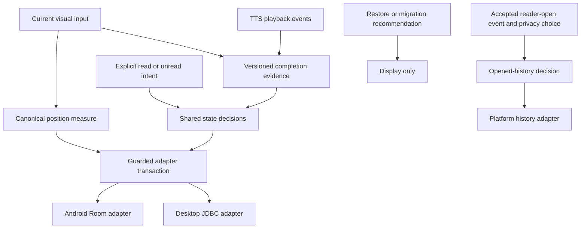

# Shared reading state

This contract defines the next work under [#432](https://github.com/Operation-Grimoire/grimoire/issues/432).
Its contract task is [#443](https://github.com/Operation-Grimoire/grimoire/issues/443),
under [roadmap #397](https://github.com/Operation-Grimoire/grimoire/issues/397).
The pure model and decisions are implemented under #445. The DAO protocol,
transactional adapters, schema expansion and production writer adoption remain
future work; the requirements below distinguish that target from current behavior.

Both readers already use [guarded portable checkpoints](reading-anchors.md).
This contract keeps position, completion and history separate while defining the
shared decisions and the adapter proof needed to connect them.

## Existing behavior to preserve

The source inventory below describes the implementation at `f4520a9` (#431).
It is evidence for compatibility, not a claim that these paths already satisfy
the future ordering and transaction requirements.

| Entry point | Current Android behavior | Current desktop behavior |
| --- | --- | --- |
| Visual input | After the load/input gate, store the first visible rendered index/pixels and a fraction based on the last visible item. The denominator includes title/footer items. | Store a guarded per-chapter block checkpoint and a legacy chapter/index/pixel position. No stored completion fraction. |
| Automatic completion | An unread chapter becomes read at the configured percentage, items-from-end or last-item threshold. The compatibility fraction can remain below one. | No automatic read policy or read flag. |
| Next | If another chapter exists and the current chapter matches the loaded content, mark the unread current chapter read. The in-memory copy uses fraction one; the DAO call does not set stored progress to one. | Select the next requested chapter without a completion command. |
| Explicit read/unread and bulk actions | Update `read`; any accepted read=true command fills `firstReadAt` if null, even when already read. Marking unread preserves progress, anchor and existing `firstReadAt`. | No equivalent read-state command/UI yet. |
| TTS | Persist an utterance-based compatibility fraction without a portable anchor. End-of-chapter separately writes fraction one and read=true. | No equivalent TTS path. |
| Reader open/chapter switch | Launch an opened-history upsert, unless incognito is enabled when the open event is accepted. Initial reader open also updates the novel's last-read time. | Resume selection is separate from checkpoint position. No opened-history store. |
| Restore/layout/content relocation | Restore a recommendation; no new position, completion or first-read write before input. | Same checkpoint rule. |

Source references:

- [Visual fraction and input observation](../app/src/main/java/io/grimoire/app/ui/screen/reader/ReaderScreen.kt),
  [reader transitions](../app/src/main/java/io/grimoire/app/ui/screen/reader/ReaderViewModel.kt)
  and [completion predicate](../app/src/main/java/io/grimoire/app/ui/screen/reader/ReaderProgress.kt).
- [Completion preferences](../app/src/main/java/io/grimoire/app/data/preferences/ReaderPreferences.kt)
  default to items-from-end (3); percentage defaults to 95. The UI bounds are
  0..20 items and 50..100 percent. The existing name says paragraphs, but its
  current input counts rendered items, including decorations and images.
- [Chapter DAO](../app/src/main/java/io/grimoire/app/data/local/dao/ChapterDao.kt)
  writes read/first-read together. It also backfills word counts after read=true.
  Position and completion currently use separate asynchronous writes.
- [TTS playback](../app/src/main/java/io/grimoire/app/data/tts/TtsPlaybackManager.kt),
  [history DAO](../app/src/main/java/io/grimoire/app/data/local/dao/ReadingHistoryDao.kt),
  [history snapshot](../app/src/main/java/io/grimoire/app/data/local/entity/ReadingHistoryEntity.kt)
  and [session incognito switch](../app/src/main/java/io/grimoire/app/data/preferences/IncognitoManager.kt).
- [Desktop model](../desktop/src/main/kotlin/io/grimoire/desktop/ReaderModel.kt),
  [library](../desktop/src/main/kotlin/io/grimoire/desktop/LocalLibrary.kt) and
  [book metadata](../desktop/src/main/kotlin/io/grimoire/desktop/BookRecord.kt).

Incognito currently suppresses opened/browsing history. It does not suppress
position, completion, first-read statistics or the initial novel last-read update.
Keep that distinction during extraction; changing it needs a separate product decision.
Do not replay a suppressed open when incognito is turned off later.

The current `recordHistory` helper launches work without awaiting it, but does not
contain DAO exceptions itself. The nonblocking/failure-isolation requirement below
is an adoption requirement, not an existing failure guarantee.

[Backup merging](../app/src/main/java/io/grimoire/app/data/backup/BackupRestoreMerge.kt)
currently ORs read flags and takes the larger legacy progress, with its own anchor
selection. A backup first-read value takes precedence when present.
[Book reimport](../app/src/main/java/io/grimoire/app/data/book/BookImportState.kt)
retains previous state; [source migration](../app/src/main/java/io/grimoire/app/domain/migration/MigrationStateTransfer.kt)
transfers matched reading fields under its existing matching rules. None is a
portable live-sync merge algorithm. This extraction must not silently change them
or manufacture canonical progress from those legacy fields.

## Shared boundaries

The portable key remains `ChapterKey`; database row IDs, clocks, SQL connections
and UI types stay in adapters. Shared code accepts explicit policy and evidence.
Room and JDBC implement the same decisions with their own transactions.
The diagram is the target boundary, not the current runtime module graph.

Preserve five separate values:

- **Current position:** the latest accepted content-relative checkpoint, which can
  move backward and belongs to a content revision.
- **Canonical position measure:** a versioned, read-only description of that
  position in the current original content. It is not a completion command.
- **Compatibility progress:** existing viewport or TTS fractions and local
  index/pixel fields. Their basis is explicit and they remain readable.
- **Completion:** `read` and the first known completion time, independent of all
  fractions and the novel's resume selection.
- **Opened history:** an accepted navigation/open event with its own timestamp,
  privacy rule and denormalized snapshot. It is not proof of reading or completion.

No furthest-read watermark is introduced. Completion and current position must not
be merged by taking the maximum fraction. Account conflict policy belongs to #441.

## Canonical position measure, version 1

Use the exact original [canonical document](../reading-core/src/main/kotlin/io/grimoire/reading/anchor/CanonicalDocument.kt),
before renderer filtering and image URI substitution. Keep every canonical ordinal
and fingerprint unchanged. Define one progress unit for each nonblank Text block
and each Image block. Blank means Kotlin `String.isBlank` on the canonical text;
do not parse HTML or normalize strings again. Separators and blank text have zero
units; title/footer decorations are absent from the canonical sequence.

Let `N` be the total units and `B(i)` the units strictly before canonical ordinal
`i`. For `N > 0`, the measure is:

| Valid current position | Numerator before division by `N` | Precision |
| --- | --- | --- |
| Start | 0 | Boundary |
| BlockStart at `i` | `B(i)` | Block boundary; no within-block estimate |
| TextOffset `o` in nonblank text of UTF-16 length `L` | `B(i) + o/L` | Text offset, only after existing offset/surrogate validation |
| Position on a zero-unit block | `B(i)` | Boundary; no text fraction |
| End | `N` | Boundary |

This measure counts content units, not words, pixels, visible exposure or time.
A long paragraph and an image each contribute one unit. A BlockStart in the final
unit-bearing block is below one. End, an exact final text-end offset, or a boundary
on a trailing zero-unit block can reach one. For example, the separator after the
last unit has `B(i)=N`. None of these results marks the chapter read.

Expose the measure version, key, logical revision, precision and numerator /
denominator basis together. Compute using bounded counts and finite arithmetic;
round only for display. Different revisions or versions are not comparable.
Do not overwrite Android's legacy fraction or infer a checkpoint from it.

Examples: text, separator, blank, image, text has `N=3`. The image starts at 1/3;
the final text starts at 2/3. At offset 2 in a final text of four UTF-16 code units, the measure
is `(2 + 2/4)/3 = 5/6`. A valid backward capture can reduce it again.

For `N=0`, return no measure, even for Start/End. Invalid, unsupported or
identity-mismatched anchors also have no measure. Unresolved changed content
does not become zero progress. A unique relocation can produce a read-only
recommendation labelled with the new revision; it cannot persist replacement
evidence. A renderer hiding all content does not grant capture/completion authority,
even if an old exact anchor still has a mathematical measure.

## Completion evidence and transitions

Canonical position and viewport exposure have different meanings. Keep Android's
existing automatic thresholds on explicit `AndroidViewportV1` evidence during the
first adoption. Its fraction remains `(lastVisibleIndex + 1) / totalItems`;
the items-from-end and at-end comparisons retain their current denominator and
inclusive boundaries. Do not substitute the canonical position measure or rename
the metric to imply platform-independent exposure.

For visual evidence, validate finite fraction in 0..1, nonnegative indices,
positive item count matching the loaded projection, and in-range `first <= last`
indices. A visual sample requires the same active load, current
content/session authority, visible body and enabled user input as position capture.
A restored footer or TTS-driven visual scroll cannot create that evidence.
Background audio has its own authority: require the current playback generation,
content observation, nonempty utterance plan and engine-completion event. It does
not require an open visual reader or visual input. A stale engine callback, paused
or replaced playback generation, or visual follower cannot certify audio completion.
A new canonical exposure policy needs its own
reviewed behavior change; it is not implied by the version 1 position measure.

Shared policy supports disabled automatic completion. Desktop starts disabled to
preserve its current behavior; adding a default policy or settings/UI needs a
tracked adoption decision. Android retains its existing preference values and
bounds. Platform differences are policy inputs, not copies of the decision code.

| Accepted event | Read flag | First-read time | Position / compatibility fields | Opened history |
| --- | --- | --- | --- | --- |
| Fresh input below threshold, including backward reading | Preserve | Preserve | Latest valid sample may replace an earlier one | Preserve |
| Eligible automatic threshold or current audio completion | Set true | Fill only if null | Persist only fields explicitly carried by that command | Preserve |
| Explicit mark read, including a bulk target | Set true | Fill only if null | Preserve | Preserve |
| Explicit mark unread or begin rereading | Set false | Preserve, including imported values | Preserve; restarting from Start is a separate position intent | Preserve |
| Android Next with an available successor and matching loaded chapter | Set true | Fill only if null | Preserve stored progress; do not turn the transient in-memory one into a new persistence rule | Separate accepted open for the successor |
| Restore, initial layout, relocation, content change or legacy import | Preserve | Preserve | Read-only restore recommendation; retain legacy evidence | No event generated by checkpoint work |
| Accepted explicit reader open/chapter switch | Preserve | Preserve | Resume selection remains navigation-owned | Upsert the chapter snapshot unless suppressed by the open's privacy choice |
| History clear/delete | Preserve | Preserve | Preserve | Delete only the requested history records |

Marking unread does not add a sticky manual-only lock: later fresh eligible input
can mark read again. It must be a sample accepted after the unread intent, not an
old queued threshold result. A re-read never replaces an existing first-read time.
Do not backfill missing first-read times during schema expansion solely because
an old row says read=true. A real later read command may fill null as it does now.

An adapter supplies the accepted completion timestamp once and writes it atomically
with read=true. Preserve existing Android timestamp values and precision; do not
rewrite imported values to a minimum, maximum or new clock basis. Keep word-count
backfill as a separately reported side effect, not an implicit history/position write.

An opened-history event is accepted at navigation intent, not at successful content
load. Android currently records before loading and can retain an entry for a failed
load. Reopening refreshes one entry per chapter, rather than appending completion
events. Preserve the legacy source-package/key mapping and denormalized display
snapshot; portable identity does not require rewriting historical rows.

## DAO ordering, identity and failure requirements

The [guarded storage protocol and migration plan](reading-state-storage.md) tracks
the concrete implementation under #447. Its adapter and migration proof remains
separate from the pure decision tests below.

The existing checkpoint protocol guards position writes. It does not by itself
order Android's separate `setRead`, TTS and bulk calls. An in-memory actor alone
cannot protect against another process or a recreated chapter.

Future state adapters must provide these transaction-level guarantees:

1. Prepare/read state under the requested chapter identity and a store/entity
   incarnation. A missing target is not created. An old command cannot affect a
   deleted/recreated or re-keyed chapter with the same URL or local row ID.
2. Carry a durable explicit-intent revision separate from content revision.
   Every distinct explicit read/unread command advances that revision, even when
   the read flag already has the requested value. Both explicit commands and
   automatic samples carry an observed intent revision and check it in the write
   transaction. Two distinct explicit commands prepared from the same revision
   cannot both commit; the loser reports a conflict instead of silently overwriting
   the winner. Store acceptance defines order across owners, not wall-clock time.
3. After explicit unread, reject earlier queued visual/audio completion samples.
   Rebind the active reader/playback observer to the new intent revision before
   accepting fresh input; do not relabel old samples with the new revision.
   Apply this protocol to manual, bulk, Next, visual and audio writers before
   claiming ordering. Explicit mark read/unread need not have a downloaded body or
   an unlocked/visible renderer. Automatic visual evidence requires the eligible
   visual body; audio requires the independent playback authority defined above.
4. Preserve the load/session/sequence checks for automatic position and completion.
   Serialize related commands without allowing a late chapter-A drain to select
   chapter B's resume pointer. Explicit intents for different chapters remain independent.
   Within one host, prepare successive explicit commands after the prior result,
   or cancel superseded pending intents. Do not automatically rebase a conflicted
   explicit command onto newer state without a new accepted user intent.
5. Use a stable command identity for uncertain retries. Replay the same result
   without advancing intent again or replacing the first-read timestamp. A reused
   identity with different intent is a conflict. Retire terminal stale/conflicting
   commands so they cannot block every later load.
6. Commit read/first-read and the protocol metadata for that command together.
   State which position/compatibility fields are included in a transaction. If
   checkpoint, completion, history or word-count work remains separate, report
   partial outcomes and reconcile stored state instead of claiming all succeeded.

Automatic completion that reports success must not survive a failed guarded state
transaction only in the optimistic UI. Preserve retryable pending work, reconcile
on failure/reopen, and keep accepting newer samples according to the checkpoint
contract. Do not turn an earlier timestamp or larger percentage into ordering.

Opened history is best effort and must not block chapter loading. Retry by the same
accepted event identity/time if supported; a retry does not create a new open.
Deleting history must not delete completion statistics. Its own clearing/privacy
ordering must be implemented before a shared history writer is adopted. Clear or
delete establishes a barrier for the affected history records: an earlier queued
open or retry cannot recreate them; a newly accepted open may record them again.
The event's privacy choice is captured at acceptance, preserving the existing
incognito behavior. No checkpoint retry may create a history event.

These requirements need an additive state protocol and migration review. Do not
choose table layout, alter Room/JDBC schemas or assume existing checkpoint rows
contain read-state authority in this pure-model slice.

## Equivalent acceptance scenarios

| Scenario | Required shared and adapter proof |
| --- | --- |
| Position measure | Frozen text/image/blank/separator examples; Start/End/BlockStart/TextOffset; UTF-16 boundaries; empty/unsupported/changed/relocated outcomes; renderer filtering and cached image paths cannot alter the canonical basis. |
| Existing completion boundaries | Android 94%/95% at threshold 95; total10/last5 versus last6 with 3 items remaining; last8 versus last9 at end. Disabled desktop automatic policy changes nothing. Restore alone never triggers these cases. |
| Explicit intents | Read then unread preserves position and first-read time; old queued automatic read cannot undo unread; fresh input can mark read again. Repeat the race through visual, Next, audio, bulk and two real store owners. |
| First-read and history | Null/non-null first-read, repeat read, incognito open, failed load, reopening, history clear and completion timestamps remain distinct. Verify persistent rows and UI failure reconciliation separately. |
| Failure and restart | Fail before commit, lose the reply after commit, cancel, retry, move backward, reopen and delete/recreate. Check exact results and unchanged unrelated chapter data. Retain the first failure. |
| Legacy expansion | Android viewport/TTS fractions, anchor fields, read/first-read/word count and opened-history rows survive unchanged. Desktop's known positions/resume selection stay intact; absence of old read state is not inferred unread/read history. |
| Production adoption | Exercise the same decisions through both compositions and all old writer entry points. Native helper/Room ART tests, real reader UI, physical phone, native window, process death and signed beta migration each need their own evidence. |

## Implementation sequence

Track each implementation slice as a subissue of #432 before starting it:

1. **Implemented (#445):** pure versioned position measure and completion/state
   decisions with frozen vectors. Compatibility evidence and disabled policy remain explicit.
2. Define the DAO command/observation/result protocol, then implement Room and JDBC
   transactions with real rollback/replay/intent-ordering/incarnation tests. Review
   additive migration, backup/restore interaction and downgrade requirements first.
3. Adopt both production readers and every competing manual/bulk/Next/TTS writer.
   Only mark shared-state adoption complete after those writers honor the protocol.
4. Adopt shared opened-history decisions with explicit privacy/clear ordering and
   equivalent adapter tests. Keep existing history/statistics data distinct.

Runtime slices must pass exact-head CI/review and the appropriate named beta gates.
The pure model does not change schemas, codecs or existing production writers.
Measured layout realization remains #433, broader reader durability acceptance #435,
and account identity/conflict/service work #441/#442.

## Pure model implementation and proof boundary

[`measureReadingPosition`](../reading-core/src/main/kotlin/io/grimoire/reading/state/CanonicalProgress.kt)
retains the existing resolver result, including the original evidence. Only exact
or unique relocated positions receive a measure. Its version/key/revision/precision,
unit count and exact `Long` numerator/denominator travel together; `fraction` is an
approximate presentation value. No unresolved fallback becomes zero progress.

[`decideReadingCompletion`](../reading-core/src/main/kotlin/io/grimoire/reading/state/ReadingCompletion.kt)
returns Proposed, Unchanged or Rejected. UNKNOWN retains absent old desktop state.
Explicit same-value intents still return a proposal because a future adapter must
advance durable intent ordering even if the state values do not change.
`AndroidViewportV1` checks the existing fraction/index formula and policy bounds.
Visual inputs bind load ID, original projection/revision and storage observation;
audio inputs bind independent playback ID, content and completed utterance plan.

Current contexts are caller-supplied facts, not write permits. Matching them only
computes a pure proposal. There is no DAO/session allocation, intent revision,
command receipt, clock, persistence, position mutation or history event in this model.
Future adapters must validate real authority and ordering in their transaction.
Both production readers and their manual/bulk/Next/TTS writers still use their
existing completion/history behavior until the separately tracked adoption.

Core JVM tests cover frozen position/UTF-16/overflow and completion/evidence vectors.
Consumer builds and existing host tests do not establish new state-model ART,
Android reader UI, physical-phone, process-death or competing-process acceptance.
