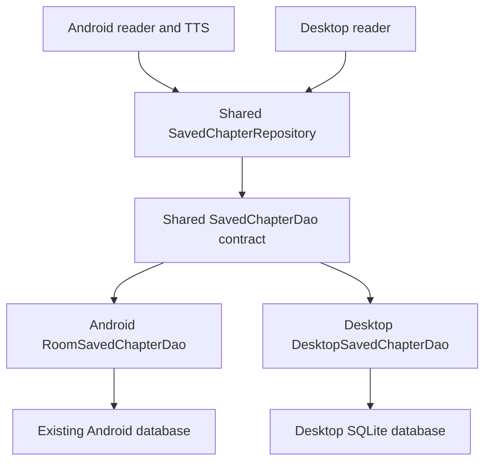
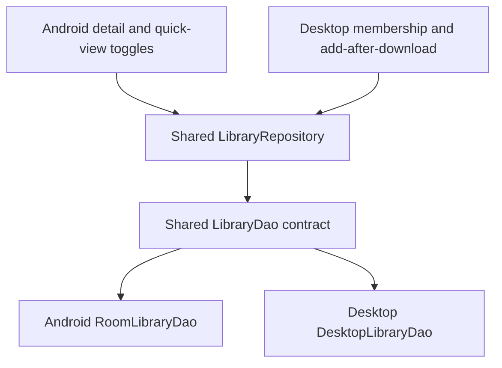
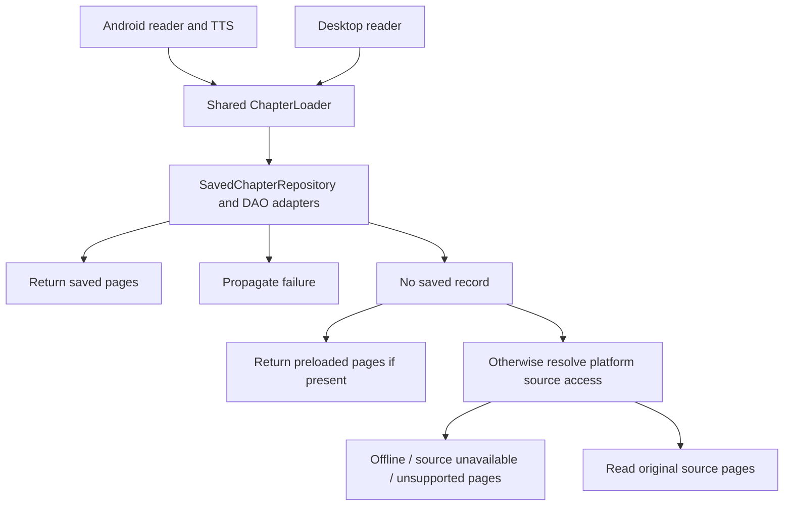

# Shared storage contracts

Android and desktop share data-access contracts and portable models. Each
platform supplies an implementation using its selected storage backend. Backend
technology remains a per-platform choice; this boundary does not require Room,
direct SQLite or a particular file format on desktop.

## Implemented first slice: saved chapter reads

`reading-core` contains `SavedChapterDao` and `SavedChapterRepository`. The DAO
accepts a `ChapterKey`: source ID, novel URL and chapter URL. Database row IDs,
Android entities, paths, connections and Room annotations stay outside it.
The existing `StoredChapterContent` model carries the payload and format version.

The repository interprets the explicit stored version through the shared codec.
It has no source, network, browser, UI or filesystem dependency. Android injects
the repository through Hilt; desktop selects its adapter in `desktopReaderModel`.

The Android reader and TTS translate their existing chapter metadata into the
portable key using the stored novel identity, not navigation URL assumptions.
`RoomSavedChapterDao` resolves that key and reads the body/version in one Room
transaction, retaining bounded body-chunk reads. Reader-specific blank-page
filtering and cached-image URI mapping remain in the Android reader.

`DesktopSavedChapterDao` delegates to the desktop library's raw saved-content read.
It retains source/novel/chapter identity, format, digest, download-index and
locked-chapter checks. The existing synchronous `LocalLibrary.downloaded` helper
remains available; production reader loading goes through the shared repository.
The desktop adapter dispatches blocking reads to IO; Room owns its query execution.
Removing library membership still retains downloaded content and position.

## Read contract

| Outcome | Required behaviour |
| --- | --- |
| No saved record | Return null; the shared loader may consider preloaded pages, then platform source access. |
| Valid legacy or current record | Return decoded pages without rewriting storage. |
| Valid empty content | Return a present empty page list, or the legacy empty-text page; never turn it into absence. |
| Invalid content/version/identity/digest | Propagate the failure; never retrieve a replacement or overwrite evidence. |
| I/O or access failure | Propagate the failure, including a missing or corrupt stored body. |
| Cancellation | Propagate cancellation unchanged. |

The adapter owns storage-level integrity and existing access checks. Feature
layers retain source permissions, locked-chapter navigation and user-facing error
handling. The shared loader below owns selection order; platforms supply source
access, including desktop offline restrictions. The DAO adds no network policy.

The initial saved-chapter extraction changed no schemas, file layouts, saved bytes,
download status, word counts, progress or writes. It retained Android database33; the
download adoption below uses DB34.
Desktop now imports those files into its own SQLite schema1; a schema2 JSON marker
prevents older readers from writing the upgraded store. See [desktop storage](desktop-storage.md) and
[chapter content](chapter-content.md) for the existing format/rollback boundary.

## Implemented second slice: library metadata and membership

`LibraryDao` and `LibraryRepository` operate on a portable `LibraryEntry`: the
novel key, display title, author, description and membership flag. Android maps
effective user overrides, including explicit empty overrides; desktop maps its
current saved metadata. This is a read projection, not a full metadata-edit API.
Category IDs, cover paths and other device-specific state remain platform-owned.

`find` returns the existing record or null. `setMembership` sets an explicit
desired value and returns its committed metadata projection, or null when the
book does not exist. It never creates a missing book, fetches metadata or deletes
downloads. Repeating the same command is idempotent. The repository rejects a
backend response for another key or an unconfirmed membership value.

Room updates only the membership column, then reads the projection in the same
transaction. It does not copy a stale whole entity over concurrent metadata.
The desktop backend patches current metadata in a SQLite transaction before
returning a committed projection. A failed pre-commit write retains the previous
membership; after a lost reply, retry the explicit desired membership value.
The Room adapter preserves Android categories and other novel fields. The desktop
adapter preserves its chapters, content, pending position and saved metadata. Library removal remains distinct from deleting saved content.

Storage/access errors and cancellation propagate. Cancellation or a lost reply
after commit does not prove that a write was rolled back; retry the explicit
desired value rather than an inverse toggle. This interface does not provide a
cross-process transaction or a universal rollback guarantee for filesystem errors.

Android retains its source/local-book gates, optimistic UI, analytics and
browsing-history cleanup in the existing view models. Category selection, bulk
operations and privacy-filtered/reactive library listings remain behind their
existing platform implementations until their contracts are extracted. Desktop
favorite and automatic membership after saving a chapter use the shared facade.
The initial membership extraction added no schema or file-format migration;
desktop subsequently moved storage as described above.

## Implemented third slice: reader loading

`ChapterLoader` owns the shared decision table, used by both visual readers and
by TTS when it needs to load chapter content. Its result includes original pages and their origin. It
checks cancellation before loading, after storage, after source-access resolution
and after source reads, including providers that return after cancellation.
Corruption, access errors, I/O failures and source errors propagate without retries.

| Saved content | Preloaded pages | Source access | Result |
| --- | --- | --- | --- |
| Present, including empty | Any | Not resolved | Saved pages |
| Read fails | Any | Not resolved | Original failure |
| Absent | Present, including empty | Not resolved | Preloaded pages |
| Absent | Absent | Offline, missing source or unsupported pages | Typed unavailable reason |
| Absent | Absent | Available | Source pages or original source failure |

Android constructs saved keys from stored novel identity, preserving row-based
navigation when source URLs change. If the stored novel is absent, a null key
skips saved lookup without inventing an identity. Android retains saved-only
blank-page filtering and local-image URI mapping; preloaded and source pages
remain unfiltered. TTS loading retains original pages and its existing immediate
source lookup. The visual reader still waits for extension readiness before lookup.
The TTS playback manager's existing active-content shortcut stays outside this
extraction: a nonempty snapshot from the visible reader is spoken directly, and
an empty snapshot requests a load. That snapshot preserves displayed page indices
and image mapping; this slice does not replace it with a potentially different
saved representation. TTS startup readiness and empty-snapshot policy are not
unified here; any later change needs playback/reader-position acceptance.
Desktop supplies no preloaded content, checks offline access only after saved
lookup, and retains source identity, locked-chapter and readable-text guards.
Each platform maps unavailable reasons to its existing error wording.

The shared module now declares coroutines-core explicitly for cancellation
checks; it uses the same 1.9.0 dependency already used by desktop and shared tests.
This slice changes no storage schema, file layout, writes or progress semantics.

## Android guarded downloads

`DownloadRepository` prepares versioned original content, digest and prose count
and validates claim/commit/lookup confirmations. `DownloadDao` uses portable
attempts and receipts with explicit committed/replayed/stale outcomes. Android's
production queue claims through this facade; success, error and connectivity
callbacks carry the attempt, including after cancellation/requeue.

`RoomDownloadDao` commits content/version, completion, word count and a receipt
together. A positive prose count replaces the old count; zero retains the old
count, which may also be zero. DB34 adds `chapter_download_state`, with cascading ownership
and receipt metadata outside chapter/progress rows. Triggers invalidate ownership
for existing cancel/delete/status, content replacement/import, identity and lock
writes. A per-store OS lease rejects a second protocol owner. Drain cleanup holds
that lease and resets work only after its child jobs finish.

Saved reads optionally carry a cache revision from the same transaction as the
body. The reader and EPUB exporter use it to select matching illustrations.
Legacy snapshots keep their existing image paths; guarded writes use revision
subdirectories. Old image work can finish in an unreferenced directory without
attaching to current/newly recreated content. Old revision files are retained
until chapter/novel deletion; conservative cache garbage collection remains later
work. Shared contracts contain no file paths or Android IDs.

Desktop now implements guarded saves using `DesktopDownloadDao` and SQLite via JDBC.
See [desktop storage](desktop-storage.md) for backend choice, migration and process tests.
Desktop process-kill and competing-process tests exercise the actual lease and
SQLite recovery. Android process-kill/competing-process acceptance remains open;
a graceful Room reopen alone does not establish those runtime gates. The
[download contract](download-commit.md) remains the acceptance target.

## Next extraction slices and acceptance gates

An interface alone is not a completed feature-sharing slice. Each slice must
name the shared product decision table or state transition, move production
callers to it, remove duplicated decisions, and run equivalent scenarios through
both platform compositions. Platform adapters may keep different backends.

1. **Guarded downloaded-text commit and recovery.** Continue implementing the
   [download-commit contract](download-commit.md). Its
   outcome table defines visibility on success, exceptions,
   cancellation before and after commit, restart recovery, crash/power-loss
   durability and ownership scope. Android now uses the shared facade, guarded
   attempts, receipts and
   revision-bound images. Desktop now uses the same facade with a JDBC transaction
   adapter. Hardware power-loss proof remains open. Complete the remaining
   restart/process-ownership acceptance through both production compositions.
   Transactions, journals, locking and recovery
   remain adapter responsibilities; backend selection stays per platform.
2. **Reading position and completion.** Define a canonical content sequence,
   portable content-relative anchor, content revision mismatch fallback, and
   preservation of legacy positions before extracting storage operations.
   The [portable reading-anchor contract](reading-anchors.md) now defines those
   decisions, projection mappings, local layout hints and guarded write outcomes.
   Its pure shared model/resolver is implemented with framing and resolution
   tests. Both production readers now retain raw content, render through shared
   projection mappings and capture provisional block anchors. The pure projection
   API also defines hidden-item fallback, now used by persisted restoration.
   Coherent load stamps are implemented through both adapters and the shared loader,
   including explicit absence before asynchronous source access. Registered sessions
   and the guarded checkpoint DAO are also implemented through both adapters. Local
   hints and historical legacy-anchor conversion remain separate. Both readers now
   adopt durable capture/restore/flush through the shared coordinator.
   Android display filtering can change indices; desktop paragraph/pixel offsets
   and Android viewport offsets are device hints, not portable anchors. Separate
   completion, explicit unread/rereading and first-read history rules.
3. **Library projections and metadata editing.** Edit commands must distinguish
   unchanged, reset override, and set (including empty); `LibraryEntry` is only a
   display projection. Category IDs are device-owned, but category membership,
   names and privacy are product semantics. Define a coherent visibility/category
   snapshot for initial loading, relock, search, totals and continue-reading.
   Resolve source URL aliasing before operations that depend on canonical identity.
4. **Feature presentation and host capabilities.** Share feature state/actions
   and reusable UI where appropriate; keep navigation, windows, viewport/input,
   file/browser/scheduler/audio implementations and device preferences local.

Shared SQL, schemas and migrations can be evaluated after contracts, alongside
selected backends. These seams do not require identical physical database layouts.
Account sync remains later work. Each device keeps local offline data; future
sync exchanges domain records under separately defined identity/conflict rules.

## Verification

Run `:reading-core:test :desktop:test :app:testDebugUnitTest` and compile
`:app:assembleDebugAndroidTest`. Shared tests distinguish absence, empty content,
corruption, access/I/O failure and cancellation. Desktop tests cover identity,
restart, retained content/position after library removal, locked reads and
non-destructive failure. The packaged-source and UI journeys use the production
desktop wiring. Existing native `ChapterCodecMigrationTest` exercises the Room
adapter with migrated content over 2 MB, source/novel/chapter isolation, new-format
reads/reopen and strict unsupported metadata. Native execution, JVM checks and
signed-nightly acceptance remain separate proof classes.

`LibraryRepositoryTest` covers identity, missing records, explicit/idempotent
commands, error propagation and lost confirmation after commit. Desktop checks
include a fail-before/pass-after blocked-file membership regression, preservation
of pending position/download bytes, restart, source isolation and the production
reader facade. Native `LibraryStorageTest` runs separately with three required
executed successes: full field/offline-state preservation, identity/missing keys,
and SQLite-trigger rollback plus cancellation-before-entry and a real in-flight
write cancelled before transaction commit. Its result is retained
as `library-result.log`; skipped tests cannot satisfy the CI count.

`ChapterLoaderTest` covers the shared selection table, unavailable capabilities,
original failure propagation and cancellation before/after every boundary.
The same saved/empty/corrupt/missing/preloaded/source/offline scenario sequence
runs through real Room and SQLite adapters. Native `ChapterCodecMigrationTest` now
requires four executed successes (plus the four host and three library tests).
Desktop packaged-source and UI journeys use the production loader composition;
these fixtures do not establish live-site or physical-phone acceptance.

`DownloadRepositoryTest` checks preparation, stale outcomes, explicit replay,
confirmation identity/count/digest/version, propagated failures and cancellation
with reconciliation after a lost reply. Native `DownloadCommitTest` requires nine
executed successes: frozen DB33 migration, commit/replay/reopen, fresh/refresh ABA
callbacks, invalidating writers, SQL fault rollback and in-flight cancellation,
single-owner refusal/reset, coherent image snapshots, production queue gates and
atomic backup restore preserving active status before invalidation.
Four additional ReaderProjectionTest cases check Android projection/capture on
ART, frozen UTF-16 framing, stale-load rejection and real legacy Room writes.
Six ChapterObservationTest cases cover real Room observation/absence,
legacy cache/field preservation, content/identity/restore ABA, live download
ownership, delayed source access, reopen scope and allocation rollback.
The script requires 41 native successes total; native execution remains separate
from compilation and the signed beta.347-to-target DB34 compatibility harness.

## Session and checkpoint adapters

The additive `ReadingCheckpointDao` shares immutable session binding, validation,
sequence ordering and exact retry/conflict decisions between Android Room and
desktop JDBC. Each adapter validates the load observation and commits checkpoint
state inside its own transaction. Reads return portable evidence without write
authority. Registration supersedes one chapter session, preserves its old anchor,
and never allocates an observation or fetches content.

Android DB35 and desktop SQL2 add isolated checkpoint tables. Legacy body/position,
cache paths, membership, receipts and history are preserved. Production readers now use the shared coordinator for portable capture/restore/flush.
Novel resume selection remains separate from checkpoint commits; legacy fields stay
as compatibility metadata and labelled fallback. See [protocol and rollback](reading-anchors.md#guarded-checkpoint-storage).
Seven native ReadingCheckpointTest cases cover the real Room protocol, ordering,
identity/invalidation, rollback/cancellation/lost reply, observer reopen and frozen
signed-DB34 migration. Compiling these cases is not proof of ART execution.

## Reader workflow adoption

Both production readers use `ReaderCheckpoints` above their platform DAOs. It shares
registration-bound restoration, explicit capture enablement, retirement, ordered
flush and retry handling. Room/JDBC remain independently selected backends. Portable
restoration is at paragraph boundaries; legacy viewport pixels are never certified
against a new layout. Measured hints and character-level realization remain separate.
See [capture/restore/flush and proof limits](reading-anchors.md#production-capture-restoration-and-flush).
Four additional native ReaderCheckpointAdoptionTest cases cover the production Android
preparation helper with real Room: mapping/reopen, retained fallback evidence, failed/
uncertain writes and stale source/retired load rejection. The script requires all 41
native successes; compiling cases alone is not native runtime acceptance.
