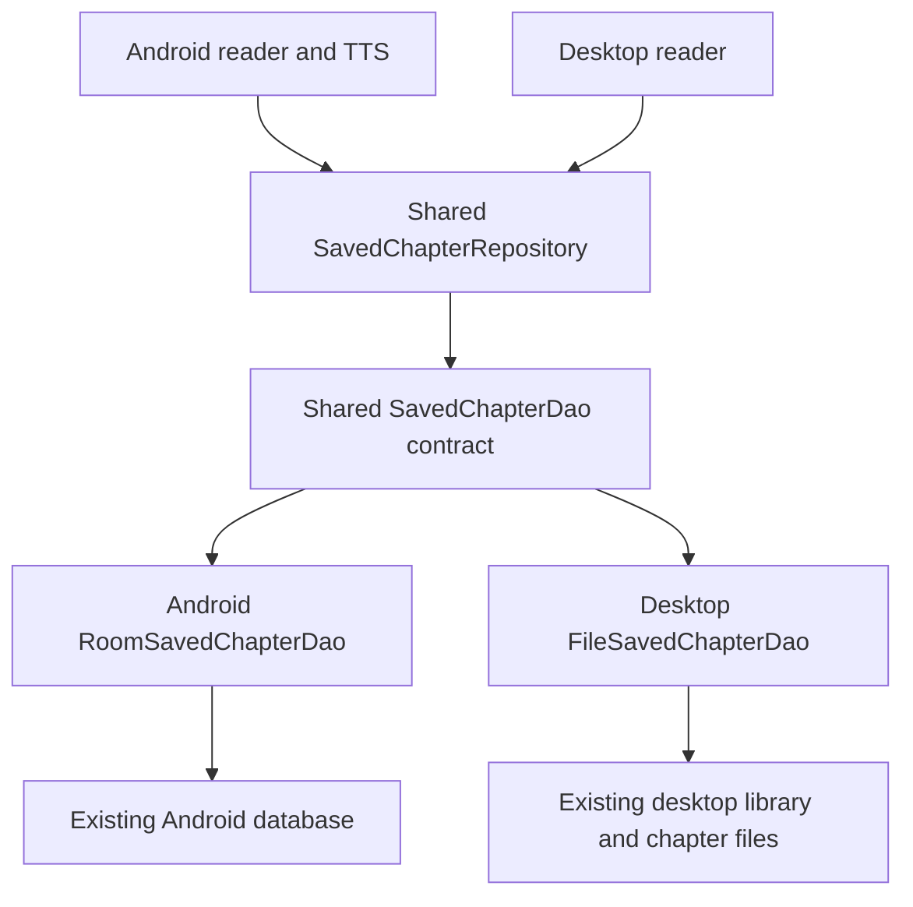
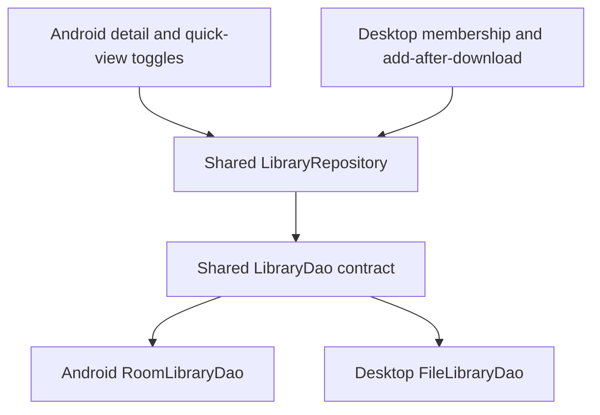

# Shared storage contracts

Android and desktop share data-access contracts and portable models. Each
platform supplies an implementation using its selected storage backend. Backend
technology remains a per-platform choice; this boundary does not require Room,
direct SQLite or a particular file format on desktop.

## Implemented first slice: saved chapter reads

`reading-core` contains `SavedChapterDao` and `SavedChapterRepository`. The DAO
accepts a `ChapterKey`: source ID, novel URL and chapter URL. Database row IDs,
Android entities, paths, connections and Room annotations stay outside it.
The existing `StoredChapterContent` model carries the payload and format version.

The repository interprets the explicit stored version through the shared codec.
It has no source, network, browser, UI or filesystem dependency. Android injects
the repository through Hilt; desktop selects its adapter in `desktopReaderModel`.

The Android reader and TTS translate their existing chapter metadata into the
portable key using the stored novel identity, not navigation URL assumptions.
`RoomSavedChapterDao` resolves that key and reads the body/version in one Room
transaction, retaining bounded body-chunk reads. Reader-specific blank-page
filtering and cached-image URI mapping remain in the Android reader.

`FileSavedChapterDao` delegates to the desktop library's raw saved-content read.
It retains source/novel/chapter identity, format, digest, download-index and
locked-chapter checks. The existing synchronous `LocalLibrary.downloaded` helper
remains available; production reader loading goes through the shared repository.
The file adapter dispatches blocking reads to IO; Room owns its query execution.
Removing library membership still retains downloaded content and position.

## Read contract

| Outcome | Required behaviour |
| --- | --- |
| No saved record | Return null; the caller may use its existing source/preloaded fallback. |
| Valid legacy or current record | Return decoded pages without rewriting storage. |
| Valid empty content | Return a present empty page list, or the legacy empty-text page; never turn it into absence. |
| Invalid content/version/identity/digest | Propagate the failure; never retrieve a replacement or overwrite evidence. |
| I/O or access failure | Propagate the failure, including an indexed desktop chapter whose file is missing. |
| Cancellation | Propagate cancellation unchanged. |

The adapter owns storage-level integrity and existing access checks. Feature
layers retain source permissions, locked-chapter navigation, offline mode,
preloaded-page precedence and user-facing error handling. This interface adds no
new network fallback or authorization policy.

Saved-chapter adapters do not change schemas, file layouts, saved bytes, download status,
word counts, progress or writes. Android remains database33; desktop library
metadata remains schema1 and new chapter files remain schema2. See
[chapter content](chapter-content.md) for the existing format/rollback boundary.

## Implemented second slice: library metadata and membership

`LibraryDao` and `LibraryRepository` operate on a portable `LibraryEntry`: the
novel key, display title, author, description and membership flag. Android maps
effective user overrides, including explicit empty overrides; desktop maps its
current saved metadata. This is a read projection, not a full metadata-edit API.
Category IDs, cover paths and other device-specific state remain platform-owned.

`find` returns the existing record or null. `setMembership` sets an explicit
desired value and returns its committed metadata projection, or null when the
book does not exist. It never creates a missing book, fetches metadata or deletes
downloads. Repeating the same command is idempotent. The repository rejects a
backend response for another key or an unconfirmed membership value.

Room updates only the membership column, then reads the projection in the same
transaction. It does not copy a stale whole entity over concurrent metadata.
The desktop backend persists a current library snapshot before publishing the
new membership in memory. Its existing file layout and atomic-replacement helper
are retained; a failed pre-commit file write leaves the previous cached membership.
The Room adapter preserves Android categories and other novel fields. The file
adapter preserves its chapters, download index, pending position and saved
metadata. Library removal remains distinct from deleting saved content.

Storage/access errors and cancellation propagate. Cancellation or a lost reply
after commit does not prove that a write was rolled back; retry the explicit
desired value rather than an inverse toggle. This interface does not provide a
cross-process transaction or a universal rollback guarantee for filesystem errors.

Android retains its source/local-book gates, optimistic UI, analytics and
browsing-history cleanup in the existing view models. Category selection, bulk
operations and privacy-filtered/reactive library listings remain behind their
existing platform implementations until their contracts are extracted. Desktop
favorite and automatic membership after saving a chapter use the shared facade.
Neither adapter adds a schema or file-format migration.

## Next extraction slices

| Responsibility | Shared direction | Platform responsibility |
| --- | --- | --- |
| Library projections and metadata editing | Reactive/list/edit contracts with privacy and category rules | Existing backend adapters and device identity mapping |
| Chapter writes and downloads | Explicit atomic-write/cancellation contracts and shared orchestration | Backend transactions, file replacement and background execution |
| Reading state | Logical anchors, read/completion rules and progress operations | Viewport/input integration and device-only preferences |
| Feature presentation | Common feature state, actions and reusable UI components | Navigation, windows, touch/keyboard/mouse behaviour |
| Host services | File, browser, scheduler and audio capability contracts | OS-specific implementations |

Each slice must move a production caller and preserve its existing behaviour.
Write contracts must retain Android's atomic content/status/word-count changes
and cancelled-download guard; a generic unguarded put would lose those semantics.
Shared SQL, schemas and migrations can be evaluated after the contracts, alongside
the selected backends. The interfaces alone do not imply backend implementation
reuse or identical physical database layouts.

Account sync remains later work. Each device keeps local offline data; future
sync exchanges domain records under separately defined identity/conflict rules.

## Verification

Run `:reading-core:test :desktop:test :app:testDebugUnitTest` and compile
`:app:assembleDebugAndroidTest`. Shared tests distinguish absence, empty content,
corruption, access/I/O failure and cancellation. Desktop tests cover identity,
restart, retained content/position after library removal, locked reads and
non-destructive failure. The packaged-source and UI journeys use the production
desktop wiring. Existing native `ChapterCodecMigrationTest` exercises the Room
adapter with migrated content over 2 MB, source/novel/chapter isolation, new-format
reads/reopen and strict unsupported metadata. Native execution, JVM checks and
signed-nightly acceptance remain separate proof classes.

`LibraryRepositoryTest` covers identity, missing records, explicit/idempotent
commands, error propagation and lost confirmation after commit. Desktop checks
include a fail-before/pass-after blocked-file membership regression, preservation
of pending position/download bytes, restart, source isolation and the production
reader facade. Native `LibraryStorageTest` runs separately with three required
executed successes: full field/offline-state preservation, identity/missing keys,
and SQLite-trigger rollback plus cancellation-before-entry and a real in-flight
write cancelled before transaction commit. Its result is retained
as `library-result.log`; skipped tests cannot satisfy the CI count.
